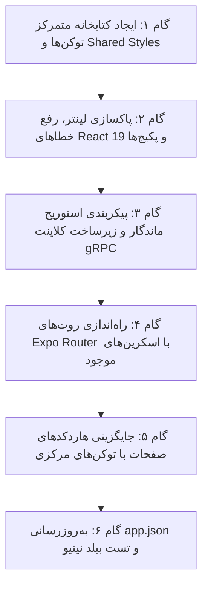

# گزارش جامع تحلیل فنی، معماری و بهینه‌سازی اپلیکیشن Ekip
## نقشه راه و راهکارهای تبدیل به محصول آماده پروداکشن در سطح جهانی (Global Production-Ready)

**تاریخ تحلیل و بازنگری:** نوامبر ۲۰۲۶  
**پلتفرم:** Expo SDK 58.0.23 / React Native 0.88.1 / React 19.3.0  
**محیط اجرا:** New Architecture (Fabric / Bridgeless)  
**معماری بک‌اند:** پروتکل ارتباطی با کارایی بالای **gRPC**  
**وضعیت فعلی:** دارای رابط کاربری و انیمیشن‌های ظاهری چشم‌نواز، اما با **بدهی فنی سنگین، هاردکدهای سرسام‌آور در استایل‌ها و انیمیشن‌ها، ضدالگوهای خطرناک و موانع اساسی برای انتشار جهانی**.

---

## فهرست مندرجات
1. [خلاصه ارزیابی و وضعیت کلان (Executive Summary)](#1-خلاصه-ارزیابی-و-وضعیت-کلان)
2. [بخش اول: بحران هاردکدها، پراکندگی استایل‌ها، رنگ‌ها و انیمیشن‌ها](#2-بخش-اول-بحران-هاردکدها-پراکندگی-استایل‌ها-رنگ‌ها-و-انیمیشن‌ها)
3. [بخش دوم: معماری شبکه مبتنی بر gRPC در برابر کلاینت منسوخ REST](#3-بخش-دوم-معماری-شبکه-مبتنی-بر-grpc-در-برابر-کلاینت-منسوخ-rest)
4. [بخش سوم: ناوبری با Expo Router با استفاده قطعی از صفحات موجود (بدون ایجاد صفحه جدید)](#4-بخش-سوم-ناوبری-با-expo-router-با-استفاده-قطعی-از-صفحات-موجود-بدون-ایجاد-صفحه-جدید)
5. [بخش چهارم: مشکلات ساختاری و مدیریت وضعیت (State & Storage)](#5-بخش-چهارم-مشکلات-ساختاری-و-مدیریت-وضعیت-state--storage)
6. [بخش پنجم: اشتباهات فاحش فنی و ضدالگوها (Critical Anti-Patterns)](#6-بخش-پنجم-اشتباهات-فاحش-فنی-و-ضدالگوها)
7. [بخش ششم: استانداردهای انتشار جهانی (شناسه‌ها، بین‌المللی‌سازی، فونت‌ها)](#7-بخش-ششم-استانداردهای-انتشار-جهانی-شناسه‌ها-بین‌المللی‌سازی-فونت‌ها)
8. [بخش هفتم: نقشه راه عملیاتی و گام‌به‌گام رفع مشکلات (Remediation Roadmap)](#8-بخش-هفتم-نقشه-راه-عملیاتی-و-گام‌به‌گام-رفع-مشکلات)

---

## ۱. خلاصه ارزیابی و وضعیت کلان

اپلیکیشن **Ekip** با هدف تبدیل شدن به یک پلتفرم اجتماعی در تراز جهانی توسعه یافته است. در تحلیل جامع سورس‌کد، سه معضل بنیادین که تاکنون روند توسعه را دچار فرسایش کرده شناسایی شد:
1. **تکرار ۹۹ درصدی استایل‌ها، رنگ‌ها، فاصله‌ها و انیمیشن‌ها** به صورت هاردکد درون فایل‌های مختلف بدون خواندن از یک سیستم دیزاین توکن متمرکز.
2. **اشتباه تاریخی در تلاش‌های قبلی برای روتینگ:** ایجاد صفحات تکراری و جدید در مسیرها به جای اتصال و استفاده از صفحات غنی و موجودِ پروژه در `src/screens/`.
3. **نبود زیرساخت ارتباطی متناسب با بک‌اند gRPC:** پروژه دارای یک کلاینت استاتیک REST منسوخ (`apiClient.ts`) است که هیچ ارتباطی با معماری واقعی بک‌اند (gRPC) ندارد.

### ماتریس ارزیابی سلامت سیستم:
| شاخص | وضعیت فعلی | استاندارد نهایی پروداکشن | وضعیت |
| :--- | :--- | :--- | :---: |
| **استایل‌ها و توکن‌ها** | هاردکد مقادیر رنگ، پدینگ و انیمیشن در ۲۰+ فایل | Design Tokens متمرکز و Shared Styles | 🔴 بحرانی |
| **لایه ارتباطی بک‌اند** | کلاینت REST بی‌استفاده و ۱۰۰٪ دیتای فیک | کلاینت مدرن Connect-RPC / gRPC با تایپ‌های Protobuf | 🔴 بحرانی |
| **ناوبری (Navigation)** | استیت دستی ۱۰۰۹ خطی در `App.tsx` | Expo Router با لایوت‌های لاغر بر روی صفحات موجود | 🔴 نیازمند اصلاح |
| **مدیریت نشست و دیتا** | JS Map در رم (پاک شدن اطلاعات با بستن اپ) | استوریج ترکیبی MMKV (دیتای سریع) + SecureStore (توکن) | 🔴 بحرانی |
| **لینتر و کامپایلر** | ۱۷۴ خطای فعال (۱۳۰ خطای شکست React 19) | ۰ خطا در `expo lint` و پاس شدن کامل TypeCheck | 🔴 نیازمند رفع |
| **شناسه‌های پکیج** | اندروید: `com.mirsoos.antigravity` / آی‌او‌اس: نامشخص | تایید شده: `app.ekip.mobile` و `app.ekip.ios` | 🟢 تأیید شد |

---

## ۲. بخش اول: بحران هاردکدها، پراکندگی استایل‌ها، رنگ‌ها و انیمیشن‌ها

### ۲.۱. معضل تکرار ۹۹ درصدی استایل‌ها و مقادیر در اسکرین‌ها
در بررسی خط‌به‌خط اسکرین‌ها (`VerificationScreen`, `SecurityScreen`, `PrivacyScreen`, `ProfileScreen`, `ActivityScreen`, `CreateScreen`, `DiscoverScreen`, `ChatScreens`) مشاهده شد که استایل‌های یکسان ده‌ها بار بازنویسی شده‌اند:
* **رنگ‌های هاردکد مکرر در سراسر سورس‌کد:**
  - رنگ‌های گرادینت امضای اکیپ: `'#f472b6'` (صورتی) و `'#3b82f6'` (آبی) در بیش از ۳۵ نقطه پروژه به صورت رشته استاتیک نوشته شده‌اند.
  - رنگ‌های پس‌زمینه و پوسته تاریک و روشن: `'#020306'`, `'#080c14'`, `'#dde2ec'`, `'#f1f5f9'`, `'#04060c'` مستقیماً در استایل‌های درون‌خطی تکرار شده‌اند.
  - شیشه‌های تکراری با ترنسپرنسی دستی: `'rgba(255, 255, 255, 0.08)'`, `'rgba(255, 255, 255, 0.15)'`, `'rgba(255, 255, 255, 0.25)'`.
* **فاصله‌گذاری‌ها، حاشیه‌ها و رادیوس‌های تکراری:**
  - مقادیر `paddingHorizontal: 16`, `paddingBottom: 100 + insets.bottom`, `borderRadius: 20`, `borderRadius: 24`, `gap: 12`, `gap: 16` در تمامی فایل‌های اسکرین بدون ارجاع به توکن مرکزی تکرار شده‌اند.
* **انیمیشن‌های تکراری و غیرمتمرکز:**
  - انیمیشن‌های ورود صفحه با ترنزیشن `translateY: 20 -> 0` و `opacity: 0 -> 1` با مقادیر هاردکد:
    ```typescript
    Animated.timing(anim, {
      toValue: 1,
      duration: 380,
      easing: Easing.bezier(0.16, 1, 0.3, 1),
      useNativeDriver: true,
    })
    ```
    در ۱۵ کامپوننت مختلف کپی-پیست شده است به جای اینکه از یک هوک انیمیشن یکتا (`useEntranceAnimation`) یا کامپوننت پایه مشترک (`MotionView`) خوانده شود!

### ۲.۲. راهکار متمرکزسازی سیستم دیزاین (Single Source of Truth Design System)
تمام این مقادیر باید از فایل‌های توکن مرکزی در `@/lib/theme` خوانده شوند:
```
src/lib/theme/
├── colors.ts        # تمام توکن‌های رنگی لایت، دارک، شیشه‌ای، برند و وضعیت‌ها
├── spacing.ts       # مقیاس‌های اسپیسینگ (xs تا xxxl)، رادیوس‌ها و ابعاد لایوت
├── typography.ts    # تمام سبک‌های متنی، وزن‌ها، سایزها و ارتفاع خطوط
├── animations.ts    # مدت‌زمان‌ها، منحنی‌های Easing، کانفیگ‌های Spring و هوک‌های انیمیشن
└── sharedStyles.ts  # استایل‌های مشترک کانتینرها، شیشه‌ها، جداکننده‌ها و هدرها
```
هیچ برنامه‌نویسی نباید مقدار هاردکد مثل `color: '#f472b6'` یا `padding: 16` بنویسد؛ همگی ملزم به استفاده از توکن‌های استاندارد هستند:
```typescript
// استانداردسازی استایل‌ها
import { colors, spacing, typography, sharedStyles } from '@/lib/theme';
```

---

## ۳. بخش دوم: معماری شبکه مبتنی بر gRPC در برابر کلاینت منسوخ REST

### ۳.۱. ماهیت بک‌اند جدید
با توجه به اعلام کارفرما مبنی بر پیاده‌سازی بک‌اند با **gRPC**، فایل فعلی `src/services/api/apiClient.ts` که یک کلاینت ساده HTTP/REST است، کاملاً ناکارآمد و غیرقابل استفاده است.

### ۳.۲. راهکار مدرن اتصال به gRPC در React Native
در اکوسیستم ری‌اکت‌نیتیو و فرانت‌اند مدرن، بهترین و پرسرعت‌ترین راهکار تعامل با gRPC استفاده از **Connect-RPC (`@connectrpc/connect` و `@connectrpc/connect-web`)** است:
1. **مزایای فوق‌العاده Connect-RPC برای پروژه Ekip:**
   - پشتیبانی بومی از تایپ‌های تولیدشده با Protobuf (`.proto`) و پروتکل gRPC / gRPC-Web بدون نیاز به پل‌های سنگین نیتیو.
   - سرعت سریالایزیشن باینری تا ۱۰ برابر سریع‌تر از JSON سنتی (مصرف دیتای اینترنت کمتر، مناسب برای چت و فید زنده).
   - تایپ‌سیفتی ۱۰۰ درصدی End-to-End بین بک‌اند و فرانت‌اند.
   - قابلیت Streaming برای دریافت زنده رویدادهای چت، نوتیفیکیشن‌ها و وضعیت آنلاین بودن.
2. **معماری لایه شبکه gRPC:**
   ```
   src/services/grpc/
   ├── transport.ts     # ترنسپورت متصل به سرور gRPC با هدرهای Auth و رهگیری خطا
   ├── interceptors.ts  # اینترسپتورهای خودکار برای افزودن JWT Token و مدیریت لاگ‌اوت
   └── clients/         # کلاینت‌های تولیدشده پروتوباف (AuthService, EkipService, ChatService)
   ```
3. **ادغام با TanStack Query:** کلاینت‌های gRPC درون هوک‌های React Query قرار می‌گیرند تا کشینگ هوشمند، تلاش مجدد (Retry)، و حالت آفلاین را بدون کد اضافی مدیریت کنند.

---

## ۴. بخش سوم: ناوبری با Expo Router با استفاده قطعی از صفحات موجود (بدون ایجاد صفحه جدید)

### ۴.۱. آسیب‌شناسی تلاش‌های ناموفق قبلی
کارفرما تأکید داشت که در دفعات پیشین، دستور روتینگ منجر به تولید صفحات تکراری و ناقص شده و صفحات کارشده و اصلی پروژه نادیده گرفته شده‌اند!

### ۴.۲. قانون تغییرناپذیر روتینگ در این پروژه
* **هیچ صفحه جدیدی (New Screen) نوشته نخواهد شد!**
* تمام صفحات اصلی و بی‌نقص فعلی که در پوشه `src/screens/` مستقر هستند (نظیر `DiscoverScreen`, `ActivityScreen`, `CreateScreen`, `ChatScreens`, `ProfileScreen`, `EkipDetail`, `AIAssistant`, `SettingsScreen`, `PersonalInfoScreen`, `VerificationScreen`, `SecurityScreen`, `PrivacyScreen`, `LocationScreen`, `ChatThemeScreen`)، **دقیقاً به عنوان بدنه و اسکلت اصلی صفحات باقی می‌مانند**.
* پوشه `app/` در Expo Router صرفاً و منحصراً شامل **کنترلرهای باریک و لاغر (Thin Route Wrappers زیر ۲۵ خط)** خواهد بود که وظیفه دارند:
  1. پارامترهای آدرس را با `useLocalSearchParams()` از روت بخوانند.
  2. صفحه اصلی موجود در `src/screens/` را ایمپورت کرده و نمایش دهند.
  3. اکشن‌های ناوبری مانند برگشت و جابجایی بین صفحات را به `router.push()` و `router.back()` متصل کنند.

#### نمونه استاندارد یک فایل روت در `app/` بدون بازنویسی صفحه:
```tsx
// app/group/[id].tsx (فقط ۲۰ خط کد - بدون ایجاد صفحه جدید!)
import React from 'react';
import { useLocalSearchParams, useRouter } from 'expo-router';
import { EkipDetail } from '@/screens/EkipDetail';
import { useEkipStore } from '@/store/ekipStore';

export default function GroupRoute() {
  const { id } = useLocalSearchParams<{ id: string }>();
  const router = useRouter();
  const group = useEkipStore((s) => s.groups.find((g) => g.id === id));

  if (!group) return null;

  return (
    <EkipDetail
      group={group}
      onBack={() => router.back()}
      onOpenProfile={(uid) => router.push(`/profile/${uid}`)}
      onOpenChat={(cid) => router.push(`/chat/${cid}`)}
    />
  );
}
```
با این روش، ۱۰۰٪ زحمات کشیده‌شده روی صفحات موجود حفظ شده و فایل ۱۰۰۰ خطی `App.tsx` با نظم کامل جایگزین می‌شود.

---

## ۵. بخش چهارم: مشکلات ساختاری و مدیریت وضعیت (State & Storage)

### ۵.۱. حذف کانتکست مونولیت `AppDataContext` و خالص‌سازی Zustand
* تمام داده‌ها در حال حاضر از طریق یک کانتکست واحد عرضه می‌شوند که باعث ری‌رندر سراسری می‌شود.
* راه حل: اتصال مستقیم صفحات موجود به استورهای تفکیک‌شده Zustand (`useAuthStore`, `useEkipStore`, `useNotificationStore`, `useChatStore`) با سلکتورهای اتمیک:
  ```typescript
  // ری‌رندر فقط زمانی که تعداد نوتیفیکیشن تغییر کند
  const unreadCount = useNotificationStore(s => s.unreadCount);
  ```

### ۵.۲. اصلاح لایه استوریج (`storageService.ts`)
* ذخیره‌سازی فعلی که در یک `Map` موقت در حافظه رم است، بلافاصله بازنویسی می‌شود:
  - توکن‌های احراز هویت: ذخیره امن در `expo-secure-store`.
  - تنظیمات، زبان، تم و دیتای کش: ذخیره پرسرعت در `react-native-mmkv`.

---

## ۶. بخش پنجم: اشتباهات فاحش فنی و ضدالگوها

1. **حذف فوری مانکی‌پچ `Object.defineProperty` در `index.ts`:**
   دستکاری هسته کامپوننت‌های نیتیو ری‌اکت حذف شده و از کامپوننت مشترک تایپوگرافی یا تنظیمات استایل عمومی استفاده می‌شود.
2. **اصلاح ۱۳۰ خطای React 19 در انیمیشن‌ها:**
   تبدیل الگوی تخلف‌آمیز `useRef(new Animated.Value(...)).current` به `useState(() => new Animated.Value(...))` یا مقادیر اشتراکی Reanimated (`useSharedValue`).
3. **نصب وابستگی حیاتی Reanimated:**
   نصب `react-native-worklets` برای برطرف کردن ارور `expo-doctor` و ممانعت از کرش نیتیو.
4. **حذف لودینگ ۲ ثانیه‌ای مصنوعی در `Loading.tsx`:**
   اپلیکیشن باید بلافاصله پس از لود شدن دیتای اولیه، صفحه اصلی را نمایش دهد.

---

## ۷. بخش ششم: استانداردهای انتشار جهانی (شناسه‌ها، بین‌المللی‌سازی، فونت‌ها)

### ۷.۱. شناسه‌های تاییدشده اپ‌استورها (Bundle Identifiers)
* **اندروید:** `app.ekip.mobile` (جایگزین `com.mirsoos.antigravity`)
* **آی‌او‌اس:** `app.ekip.ios`
* **اسکیما دیپ‌لینکینگ:** `ekip://` و یونیورسال لینک `ekip.app` برای هدایت مستقیم به اکیپ‌ها و چت‌ها.

### ۷.۲. اصلاح فونت و چندزبانی
* اضافه کردن فونت بین‌المللی باکیفیت لاتین (**Inter**) برای متون انگلیسی در کنار فونت فارسی موجود.
* ذخیره ماندگار زبان انتخابی کاربر در استوریج دائمی.
* حذف هاردکد `I18nManager.allowRTL(false)` و مدیریت صحیح جهت‌گیری متن‌ها و المان‌ها.

---

## ۸. بخش هفتم: نقشه راه عملیاتی و گام‌به‌گام رفع مشکلات



### گام ۱: سیستم متمرکز توکن‌ها و استایل‌های مشترک (Design System Consolidation)
* تجمیع تمام رنگ‌ها در `src/lib/theme/colors.ts`.
* تجمیع اسپیسینگ‌ها، پدینگ‌ها و رادیوس‌ها در `src/lib/theme/spacing.ts`.
* تعریف استایل‌های پرتکرار (کارت‌ها، دکمه‌ها، چیپ‌ها، ترنزیشن‌های انیمیشن) در `src/lib/theme/sharedStyles.ts`.

### گام ۲: رفع خطاهای کامپایلر، پکیج‌ها و مانکی‌پچینگ
* نصب `react-native-worklets` و اجرای `npx expo install --fix`.
* پاکسازی مانکی‌پچ `index.ts`.
* اصلاح دسترسی به رفرنس‌ها در رندر برای به صفر رساندن ارورهای `expo lint`.

### گام ۳: استوریج دائمی و کلاینت پروتکل gRPC
* راه‌اندازی `storageService` با MMKV و SecureStore.
* تنظیم زیرساخت ترنسپورت gRPC با Connect-RPC آماده برای اتصال به سرویس‌های بک‌اند.

### گام ۴: روتینگ تمیز Expo Router مبتنی بر اسکرین‌های موجود
* ساخت پوشه `app/` و لایوت‌های مربوطه.
* تعریف روت‌های لاغر که صرفاً صفحات موجود در `src/screens/` را لود و متصل می‌کنند (بدون نوشتن صفحه جدید).
* انتقال هدرها و باتم‌ناو به لایوت‌های پایدار.

### گام ۵: ریفکتور اسکرین‌های موجود با توکن‌های متمرکز
* پاکسازی مقادیر هاردکد درون صفحات موجود و جایگزینی با توکن‌های استخراج‌شده در گام ۱.

### گام ۶: کانفیگ استورها و اعتبارسنجی نهایی
* ثبت شناسه‌های `app.ekip.mobile` و `app.ekip.ios` در `app.json`.
* اجرای تست سلامت با `npx expo-doctor` و تایپ‌چک کامل با `npx tsc --noEmit`.
